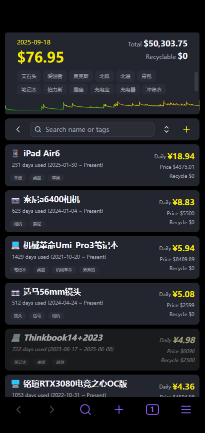

# LaC.CostSet — 在 Obsidian 中用代码管理物品

[中文](README.zh-CN.md) | [English](README.md)

管理你的物品清单：在 Markdown 文件中嵌入结构化的 TOML 数据，记录价格、购入与结束日期、标签以及可回收价值。插件会提供趋势图、筛选和编辑界面，方便你追踪每日成本。



## 功能一览

- **专用视图**：在独立视图中以卡片形式呈现物品，总览总成本并查看趋势图。
- **首次运行示例**：若配置的入口文件不存在，自动生成示例入口与物品文件。
- **读写 TOML**：保留注释，支持 Markdown 内的 `[[Wikilink]]`。
- **筛选 / 搜索 / 排序**：根据标签、名称、每日成本、购入价格、购入日期等条件筛选或排序。
- **就地编辑**：卡片点击编辑，长按可临时隐藏（不写回文件）。
- **本地优先**：所有数据保存在你的 Vault 中。

## 如何打开视图

- 命令面板执行 “Open LaC.CostSet”（命令 ID：`open-lac-costset`）。
- Markdown 文件右键菜单选择 “Open with LaC.CostSet”（需在设置中启用）。

> 视图类型为 `lac-costset-view`。Obsidian 会在保存的布局中自动恢复本视图，但插件不会主动重新打开它。

## 入口文件格式

入口文件是 Markdown 文档，顶部需包含最小 TOML 头部，正文用 Wikilink 列出物品文件。

```toml
# 顶部 TOML
type = "root"
renders = ["costset"]

# 正文：列出物品文件（不含扩展名）

[[Keyboard]]
[[Headphones]]
```

- 文件扩展名可为 `.md`。
- `#` 开头的注释会被保留。
- 正文中的 Wikilink 可不加引号；插件仅在解析时临时加引号。

## 物品笔记格式（TOML）

每个物品笔记的 TOML 键处于顶层，保存时插件只会更新相关键并保留注释。

```toml
name = "Thinkbook14p2025"

[style]
icon = "💻"

[detail]
price = 7999
active_from = "2023-01-01"
active_to = ""
recycle_price = 1200
tags = ["computer", "work"]
```

每日成本计算方式为 `(price - recycle_price) / daysUsed`，天数范围从 `active_from` 到当前选择日期（若有 `active_to` 则截止于结束日期）。趋势图在到达结束日前会把 `recycle_price` 视作 `0`。

## 界面概览

- 顶部：总览数据、标签筛选、日期选择器、成本趋势图。
- 操作栏：搜索框、排序按钮（每日成本 / 价格 / 购入日期）、新增按钮。
- 物品卡片：名称、日期、标签、每日成本、价格、可回收价；点击编辑，长按隐藏，右键删除。

## 设置项

- **Entry file**：入口 Markdown 文件路径。默认 `LaC/CostSet/costset.md`。
- **Enable context menu**：在 Markdown 右键菜单中显示 “Open with LaC.CostSet”。
- **Default sort**：默认排序方式（无 / 每日成本 / 价格 / 购入日期）。
- **Default icon**：新物品默认图标（仅保留首个 Emoji）。
- **Language**：自动 / 中文 / English。

## 安装方式


### 方式一：BRAT
1. 在 Obsidian 社区插件中安装 BRAT。
2. 打开 BRAT 设置页面。
3. 点击 “Add Beta plugin”，输入仓库地址：`alvinfunborn/lac-costset`。
4. 回到社区插件列表启用 LaC.CostSet，BRAT 会自动拉取最新发布包。

### 方式二：手动安装
1. 前往 GitHub Releases 下载最新压缩包。
2. 解压后，若 Vault 中尚无 `.obsidian/plugins/lac-costset`，请创建该目录，并将发布包内容复制进去。
3. 在设置 → Community plugins 中启用 LaC.CostSet。

## 注意事项

- “Hidden” 是临时隐藏，仅作用于当前视图，不会写回文件。
- 插件只会重写与 costset 相关的字段（`name`、`style.icon`、`detail.*`），会保留开头注释。

## 技术栈

- Obsidian Plugin API
- 轻量级 TOML 读写器（保留注释与 Wikilink 支持）
- 响应式界面，移动端友好，数据离线保存

## 许可证

MIT License

打包依赖的完整许可证见 [THIRD_PARTY_NOTICES.txt](THIRD_PARTY_NOTICES.txt)，分发的 `main.js` 中也包含这些声明。


## 隐私与网络使用

本插件离线工作，不使用网络服务。
